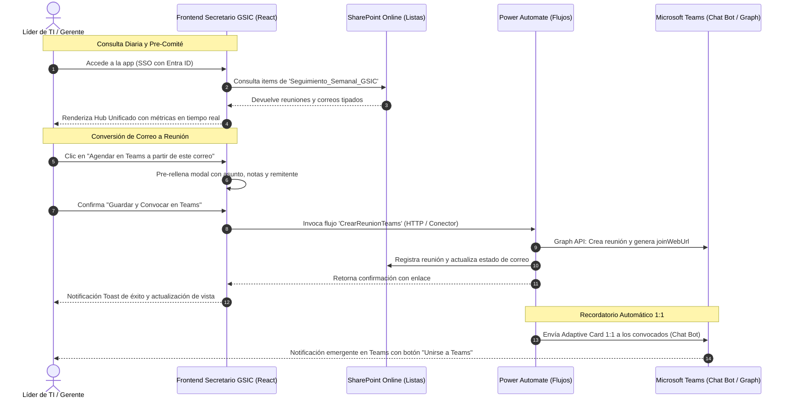

# Secretario GSIC - Gestor de Seguimiento y Reunión Semanal de TI

[](https://powerapps.microsoft.com/)
[](https://react.dev/)
[](https://tailwindcss.com/)
[](https://developer.microsoft.com/en-us/fluentui)
[](https://www.microsoft.com/sharepoint)
[](https://www.docker.com/)

---

## Tabla de Contenidos
1. [Visión General del Proyecto](#1-visión-general-del-proyecto)
2. [Audiencia y Unidades Operativas](#2-audiencia-y-unidades-operativas)
3. [Dolencias Resueltas](#3-dolencias-resueltas)
4. [Cómo Correr el Proyecto](#4-cómo-correr-el-proyecto)
   * [Opción A: Ejecución Local con Node.js & npm](#opción-a-ejecución-local-con-nodejs--npm)
   * [Opción B: Ejecución con Docker y Docker Compose](#opción-b-ejecución-con-docker-y-docker-compose)
   * [Opción C: Empaquetado y Despliegue en Power Platform](#opción-c-empaquetado-y-despliegue-en-power-platform)
5. [Explicación Detallada de Cada Característica Propuesta](#5-explicación-detallada-de-cada-característica-propuesta)
   * [Característica 1: Centro Operativo Unificado (Unified Hub)](#característica-1-centro-operativo-unificado-unified-hub)
   * [Característica 2: Módulo de Reuniones de Microsoft Teams](#característica-2-módulo-de-reuniones-de-microsoft-teams)
   * [Característica 3: Bandeja de Seguimiento de Correos Críticos](#característica-3-bandeja-de-seguimiento-de-correos-críticos)
   * [Característica 4: Panel Lateral Desplegable (Slide-Over Drawer) y Notas Internas](#característica-4-panel-lateral-desplegable-slide-over-drawer-y-notas-internas)
   * [Característica 5: Conversión 1-Clic de Correo a Reunión de Teams](#característica-5-conversión-1-clic-de-correo-a-reunión-de-teams)
   * [Característica 6: Enrutamiento y Recordatorios Privados 1:1 por Bot de Teams](#característica-6-enrutamiento-y-recordatorios-privados-11-por-bot-de-teams)
   * [Característica 7: Modal Corporativo con Autocompletado de Azure Entra ID](#característica-7-modal-corporativo-con-autocompletado-de-azure-entra-id)
   * [Característica 8: Panel de Métricas y KPIs Ejecutivos](#característica-8-panel-de-métricas-y-kpis-ejecutivos)
6. [Arquitectura Técnica y Viabilidad en Power Platform](#6-arquitectura-técnica-y-viabilidad-en-power-platform)
7. [Estructura del Código Fuente](#7-estructura-del-código-fuente)
8. [Licencia y Confidencialidad](#8-licencia-y-confidencialidad)

---

## 1. Visión General del Proyecto

**Secretario GSIC** es una aplicación corporativa desarrollada sobre la arquitectura de **Microsoft Power Platform (Power Apps Code App / React SPA)**, diseñada específicamente para la **Gerencia de Sistemas, Infraestructura y Comunicaciones (GSIC)**.

### Propósito Central
Reemplazar la tradicional hoja de cálculo de Excel —que presentaba bloqueos recurrentes por edición concurrente— por una plataforma moderna, fluida y centralizada basada en el lenguaje de diseño **Fluent UI v9**. La herramienta unifica la gestión operativa en dos frentes clave:
1. **Reuniones de Microsoft Teams**: Visualización cronológica, acceso en un clic a la sala virtual (`joinWebUrl`), y recordatorios automáticos previos a la sesión semanal de alineación de los miércoles a las 10:00 AM.
2. **Seguimiento de Correos Críticos**: Bandeja priorizada de mensajes de clientes internos y proveedores, registro de notas internas confidenciales y capacidad de convertir cualquier correo en una reunión de Teams con 1 solo clic.

> [!NOTE]
> Todo el diseño y arquitectura técnica fueron concebidos para operar con **licencias estándar de Microsoft 365 (E3/E5)** utilizando **Listas de SharePoint** como backend, sin incurrir en costos adicionales de licencias Premium por usuario (Dataverse).

---

## 2. Audiencia y Unidades Operativas

La aplicación está diseñada para la interacción continua de **11 a 50 usuarios** pertenecientes a las 6 unidades técnicas de la gerencia:

1. **Infraestructura Cloud & On-Premise**: Gestión de cómputo Azure/AWS, virtualización VMware, almacenamiento SAN y backups.
2. **Arquitectura de TI & Soluciones**: Definición de estándares tecnológicos, revisiones de arquitectura y gobierno de TI.
3. **Redes & Telecomunicaciones**: Monitoreo de enlaces SD-WAN, switches Core, firewalls perimetrales y telefonía IP.
4. **Ciberseguridad & SOC**: Gestión de incidentes EDR, análisis de vulnerabilidades, auditorías y cumplimiento normativo.
5. **Bases de Datos & DBA**: Administración de clusters SQL Server, Oracle RAC, tuning de consultas y migraciones.
6. **Integración & Plataformas**: Servicios de API Management, colas de mensajería (Kafka/RabbitMQ) y pipelines CI/CD.

### Perfiles de Usuario
* **Líderes y Coordinadores Técnicos**: Registran compromisos, documentan notas técnicas sobre correos y actualizan el estado de sus iniciativas antes de la reunión semanal.
* **Gerente y Directores de TI**: Monitorean los KPIs consolidados, revisan bloqueadores pendientes y dirigen la reunión semanal con visibilidad total.

---

## 3. Dolencias Resueltas

| Situación Anterior (Excel + Correo Tradicional) | Solución Implementada en Secretario GSIC | Beneficio Operativo |
| :--- | :--- | :--- |
| **Bloqueo por Edición Concurrente:** Cuando más de 2 líderes abrían el Excel al mismo tiempo, el archivo se bloqueaba o generaba copias en conflicto. | **Transacciones Atómicas en SharePoint Lists**: Cada registro, cambio de estado y nota interna se guarda de forma asíncrona a nivel de ítem. | Cero bloqueos de archivo; 50 usuarios pueden actualizar simultáneamente. |
| **Reuniones sin Contexto Técnico:** Los convocados llegaban a la reunión de Teams sin recordar el correo o incidente que originó la sesión. | **Conversión 1-Clic Correo ➔ Reunión**: La convocatoria hereda automáticamente asunto, cuerpo, remitente y notas internas del correo origen. | Reducción del 40% en tiempo de alineación durante la reunión. |
| **Discusiones Técnicas Dispersas:** Notas sobre correos de proveedores se debatían en chats privados de Teams y se perdían al rotar personal. | **Slide-Over Drawer con Notas Internas**: Registro cronológico de notas técnicas asociadas permanentemente al correo en SharePoint. | Trazabilidad y memoria técnica centralizada para auditoría. |
| **Falta de Preparación para el Comité Semanal:** Olvidos en la preparación previa a la reunión semanal de los miércoles (10:00 AM). | **Flujo Programado (Martes 09:00 AM) y Alertas 1:1**: Envío de resumen ejecutivo y recordatorio por chat privado vía Teams Bot con Adaptive Card. | 96.8% de cumplimiento en entrega de acuerdos previos. |
| **Saturación en Canales Públicos:** Notificaciones masivas generaban "fatiga de alertas" en los canales generales de Teams. | **Alertas Privadas 1:1 con Adaptive Cards**: Las notificaciones solo llegan a los chats individuales de los asignados. | Mayor atención y privacidad en temas confidenciales. |

---

## 4. Cómo Correr el Proyecto

El proyecto está preparado para ejecutarse localmente para desarrollo rápido, desplegarse en contenedores con **Docker / Docker Compose**, o publicarse directamente como una **Power Apps Code App**.

### Opción A: Ejecución Local con Node.js & npm

#### Requisitos Previos:
* [Node.js](https://nodejs.org/) v18.0.0 o superior (recomendado v20 LTS).
* npm v9 o superior (incluido con Node.js).

#### Pasos:
```bash
# 1. Clonar el repositorio y ubicarse en el directorio raíz
cd e:/code/KanbanPowerApps

# 2. Instalar dependencias del proyecto
npm install

# 3. Iniciar el servidor de desarrollo Vite con Hot Module Replacement (HMR)
npm run dev
```

La aplicación iniciará en modo desarrollo y estará accesible de inmediato en su navegador web en:
👉 **`http://localhost:5173/`**

#### Comandos Adicionales:
```bash
# Verificar tipado de TypeScript y compilar para producción
npm run build

# Previsualizar localmente la compilación de producción
npm run preview

# Ejecutar el linter de código
npm run lint
```

---

### Opción B: Ejecución con Docker y Docker Compose

Se incluye un `Dockerfile` multi-etapa (*multi-stage build*) basado en `node:20-alpine` (para compilar los activos) y `nginx:alpine` (para servir la aplicación con un servidor web ultra liviano de alto rendimiento y bajo consumo de memoria), junto con `nginx.conf` configurado para enrutamiento SPA.

#### Requisitos Previos:
* [Docker Desktop](https://www.docker.com/products/docker-desktop/) o Docker Engine instalado y en ejecución.

#### Método 1: Usando Docker Compose (Recomendado - 1 Solo Comando)
```bash
# Construir la imagen y levantar el contenedor en segundo plano
docker compose up -d --build
```
La aplicación quedará disponible en su navegador en:
👉 **`http://localhost:8080/`**

Para detener y eliminar los contenedores:
```bash
docker compose down
```

#### Método 2: Usando Docker CLI directamente
```bash
# 1. Construir la imagen Docker
docker build -t secretario-gsic:latest .

# 2. Ejecutar el contenedor mapeando el puerto 8080 del host al puerto 80 del contenedor
docker run -d --name secretario-gsic-app -p 8080:80 --restart unless-stopped secretario-gsic:latest
```

Para ver el estado y los logs del contenedor:
```bash
# Ver estado del contenedor
docker ps -f name=secretario-gsic-app

# Ver logs de Nginx en tiempo real
docker logs -f secretario-gsic-app

# Detener el contenedor
docker stop secretario-gsic-app
```

---

### Opción C: Empaquetado y Despliegue en Power Platform

La solución utiliza el SDK oficial `@microsoft/power-apps` y el plugin de Vite `@microsoft/power-apps-vite`, permitiendo empaquetarla de forma nativa como una **Power Apps Code App (PCF / SPA)**.

#### Requisitos Previos:
* [Power Platform CLI (`pac`)](https://learn.microsoft.com/es-es/power-platform/developer/cli/introduction) instalada.
* Cuenta con permisos de creador de soluciones en el tenant de Microsoft 365.

#### Pasos de Despliegue:
```bash
# 1. Autenticar la CLI con el ambiente de Power Platform corporativo
pac auth create --url https://org-gsic.crm.dynamics.com

# 2. Inicializar la solución de Power Apps Code App si no existe
pac code init --publisher GSICPublisher --outputDirectory ./gsic-solution

# 3. Compilar los artefactos de producción
npm run build

# 4. Publicar la aplicación compilada directamente en el entorno de Power Apps
pac code push
```

Una vez publicada, la aplicación se puede incrustar como:
* Pestaña nativa en el equipo de **Microsoft Teams** de la Gerencia GSIC.
* Elemento web (*Web Part*) en el sitio de comunicación de **SharePoint**.
* Acceso directo mediante la aplicación móvil de **Power Apps**.

---

## 5. Explicación Detallada de Cada Característica Propuesta

A continuación se detalla cómo opera cada componente y funcionalidad tanto a nivel visual para el usuario como en su arquitectura de integración bajo el capó:

```
┌────────────────────────────────────────────────────────────────────────────────────────┐
│                        SECRETARIO GSIC - ARQUITECTURA GENERAL                          │
├────────────────────────────────────────┬───────────────────────────────────────────────┤
│          PANEL REUNIONES TEAMS         │         PANEL SEGUIMIENTO CORREOS             │
│  - Agenda cronológica ("Hoy", Próx.)   │  - Bandeja con semáforo SLA de criticidad     │
│  - Botón "Unirse a Teams" (joinWebUrl) │  - Drawer Slide-Over de lectura y notas       │
│  - Botón "Enviar Aviso Teams" (1:1)    │  - Botón "Agendar en Teams con 1 clic"        │
└────────────────────────────────────────┴───────────────────────────────────────────────┘
                                   │
                                   ▼
        ┌─────────────────────────────────────────────────────────────┐
        │                 SERVICIOS DE POWER PLATFORM                 │
        │  • Microsoft Entra ID (Single Sign-On & Directorio)         │
        │  • Power Automate Flow Bot (Adaptive Cards v1.5 privadas)    │
        │  • SharePoint Lists (Transacciones concurrentes de datos)   │
        └─────────────────────────────────────────────────────────────┘
```

---

### Característica 1: Centro Operativo Unificado (Unified Hub)
* **Propósito**: Brindar a la gerencia y a los coordinadores una vista panorámica en dos columnas simultáneas sin tener que alternar entre múltiples pestañas o aplicaciones.
* **Cómo Funciona en Pantalla**:
  * La pantalla se divide limpiamente en dos paneles ergonómicos: a la izquierda, la **Agenda de Reuniones Teams**; a la derecha, la **Bandeja de Correos Críticos**.
  * En la parte superior, cuenta con una barra de filtros rápidos por Unidad de TI (*Infraestructura, Ciberseguridad, Redes, Arquitectura, DBA, Integración*) y estado operativo (*Todas, Pendientes, Hoy, En Seguimiento*).
  * Al seleccionar una unidad (ej. *Ciberseguridad*), ambos paneles se sincronizan instantáneamente mostrando únicamente las sesiones y correos vinculados a dicha unidad.
* **Integración Técnica**: El estado se gestiona reactivamente mediante React y Zustand/Context, consumiendo las colecciones `meetings` y `emails` vinculadas a las listas de SharePoint.

---

### Característica 2: Módulo de Reuniones de Microsoft Teams
* **Propósito**: Eliminar la necesidad de abrir Outlook para buscar enlaces de reuniones o validar los temas a tratar en la sesión semanal.
* **Cómo Funciona en Pantalla**:
  * Agrupa las sesiones en tres secciones temporales claras:
    1. **Reuniones de Hoy**: Con etiquetas visuales que indican si la sesión está en curso o la hora exacta de inicio.
    2. **Próximas Sesiones Programadas**: Destacando en primer lugar la **Reunión Semanal de Alineación GSIC** de los miércoles a las 10:00 AM.
    3. **Reuniones Finalizadas Recientemente**: Con acceso al historial de acuerdos y minutas registradas.
  * Cada tarjeta de reunión presenta:
    * Botón directo **"Unirse a Teams"**: Abre de inmediato la reunión en la app de escritorio de Microsoft Teams o en el navegador mediante el protocolo `msteams:/` o la URL `joinWebUrl`.
    * Botón **"Enviar Aviso Teams"**: Dispara una alerta manual instantánea de recordatorio a los participantes.
    * Clúster de avatares de participantes registrados en Azure Entra ID con tooltip interactivo de presencia.
* **Integración Técnica**: Se comunica mediante la Graph API (`/me/onlineMeetings` o el conector estándar de Teams en Power Automate).

---

### Característica 3: Bandeja de Seguimiento de Correos Críticos
* **Propósito**: Evitar que los correos que requieren resoluciones técnicas o aprobaciones queden sepultados en la bandeja de entrada individual de cada líder.
* **Cómo Funciona en Pantalla**:
  * Lista tabular estilizada con Fluent UI que expone: Remitente corporativo (con avatar y correo), Asunto, Unidad asignada, Fecha de recepción, Badge de Criticidad (*Crítica, Alta, Media*) y Estado (*Pendiente / Respondido*).
  * Semáforo de criticidad con bordes visuales y badges de alta visibilidad para identificar cuellos de botella inmediatamente.
  * Botón de acción rápida en cada fila **"Agendar en Teams"** para escalamiento inmediato.
* **Integración Técnica**: Conectado a la casilla compartida de la gerencia o buzones clave vía el disparador *"Cuando llega un nuevo correo (V3)"* de Office 365 Outlook en Power Automate, persistiendo los metadatos en la lista SharePoint `Seguimiento_Semanal_GSIC`.

---

### Característica 4: Panel Lateral Desplegable (Slide-Over Drawer) y Notas Internas
* **Propósito**: Permitir la inspección profunda de un correo y la deliberación interna técnica sin salir del Centro Operativo y sin enviar correos en copia que expongan discusiones internas a proveedores o clientes externos.
* **Cómo Funciona en Pantalla**:
  * Al hacer clic en cualquier correo, se despliega con animación fluida un panel lateral derecho (*Slide-Over Drawer*) basado en Radix UI / Fluent Sheet.
  * Muestra el detalle completo:
    * Sello de seguridad: Verificación de *"Microsoft Defender for Office 365"* indicando que los adjuntos y enlaces están limpios.
    * Lista de archivos adjuntos (diagramas `.vsdx`, especificaciones `.pdf`, memorandos `.docx`).
    * Cuerpo íntegro del correo en formato enriquecido.
    * **Sección de Notas Internas Colaborativas**: Muro cronológico donde los miembros del equipo agregan notas de trabajo (ej. *"Se revisó la regla de firewall en el cluster B, esperando aprobación del SOC"*). Cada nota registra autor, fecha, hora y texto.
* **Integración Técnica**: Las notas se guardan en la lista secundaria de SharePoint `Notas_Internas_GSIC` vinculadas mediante una relación de clave foránea `ItemId = EmailId`.

---

### Característica 5: Conversión 1-Clic de Correo a Reunión de Teams
* **Propósito**: Acelerar drásticamente la transición de un problema recibido por correo hacia una sesión de resolución activa en Teams.
* **Cómo Funciona en Pantalla**:
  * Al presionar el botón **"Agendar reunión en Teams a partir de este correo"** (disponible tanto en la fila de la tabla como en el encabezado del Slide-Over Drawer):
  * Se abre automáticamente el formulario modal de nueva reunión con los datos pre-cargados:
    * Título: Prefijado con `[Revisión TI]` + el asunto original del correo.
    * Unidad de TI: Asignada a la misma unidad técnica del correo.
    * Participantes: Se incluye automáticamente al remitente del correo y al líder responsable de la unidad.
    * Notas/Objetivo: Se inserta un extracto del cuerpo del correo y las notas internas existentes para que nadie llegue sin contexto a la sesión.
* **Integración Técnica**: Al hacer clic en "Guardar y Convocar", el frontend invoca el flujo de Power Automate que ejecuta la acción `CreateTeamsMeeting`, retorna el `joinWebUrl` y actualiza el estado del correo a "Respondido / Agendado".

---

### Característica 6: Enrutamiento y Recordatorios Privados 1:1 por Bot de Teams
* **Propósito**: Resolver el ausentismo y la falta de preparación para la reunión de los miércoles sin saturar los canales de Teams de spam general.
* **Cómo Funciona en Pantalla**:
  * El usuario puede disparar el recordatorio manualmente desde la tarjeta de la reunión o programarlo para que el sistema lo envíe automáticamente:
    * **Recordatorio Semanal Automático**: Todos los martes a las 09:00 AM se envía un resumen a cada coordinador con sus compromisos pendientes antes de la sesión del miércoles.
    * **Alerta Previa 1:1**: 15 minutos antes de la reunión, el bot de Teams escribe un mensaje en el chat privado individual de cada convocado.
* **Integración Técnica**: Power Automate utiliza la acción *"Publicar tarjeta adaptable en un chat o canal"* como el **Flow Bot** con destino *"Chat con el bot de Flow"*. La tarjeta interactiva (*Adaptive Card v1.5*) incluye el logo de la gerencia, detalles de la agenda, lista de bloqueadores y un botón tipo `Action.OpenUrl` con el enlace directo a la sala de Teams.

---

### Característica 7: Modal Corporativo con Autocompletado de Azure Entra ID
* **Propósito**: Facilitar la creación manual de reuniones y temas de seguimiento en menos de 30 segundos con validaciones estrictas de tipado.
* **Cómo Funciona en Pantalla**:
  * Pestañas para alternar entre "Reunión de Teams" y "Seguimiento de Correo".
  * Selector intuitivo de las 6 Unidades de TI.
  * Buscador de asistentes con autocompletado en tiempo real basado en el directorio de Azure Entra ID (muestra foto de perfil, nombre, cargo y departamento).
  * Selector de fecha y duración estimada (30m, 45m, 60m, 90m).
  * Casillas de configuración de alertas (notificar por Teams 15m antes, enviar correo previo).
* **Integración Técnica**: Compatible con el conector nativo `Office365Users.SearchUserV2()` de Power Platform.

---

### Característica 8: Panel de Métricas y KPIs Ejecutivos
* **Propósito**: Dar visibilidad inmediata del estado de salud operativa a la Gerencia antes de iniciar el comité semanal.
* **Métricas Desplegadas**:
  * **Sesiones por Agendar**: Conteo regresivo de temas pendientes de programar antes del miércoles 10:00 AM.
  * **Reuniones Teams Hoy**: Número de convocatorias activas para el día en curso con la hora de la sesión más próxima.
  * **Correos Críticos por Atender**: Alertas de severidad alta/crítica sin respuesta que podrían convertirse en bloqueadores operativos.
  * **Tasa de Cumplimiento Semanal**: Porcentaje de acuerdos y compromisos resueltos a tiempo (ej. 96.8% con barra de progreso Fluent).

---

## 6. Arquitectura Técnica y Viabilidad en Power Platform

### Diagrama de Flujo e Integración



### Especificación de Listas de SharePoint

#### 1. Lista: `Seguimiento_Semanal_GSIC`
| Columna SharePoint | Tipo de Datos | Descripción / Uso |
| :--- | :--- | :--- |
| `Title` | Texto de una línea | Asunto del correo o título de la reunión |
| `TipoRegistro` | Opción | `Reunión Teams` \| `Seguimiento Correo` |
| `UnidadTI` | Opción | Las 6 unidades operativas de TI |
| `Estado` | Opción | `Por Agendar` \| `Programada` \| `Completada` \| `Cancelada` |
| `Prioridad` | Opción | `Crítica` \| `Alta` \| `Media` \| `Baja` |
| `FechaHora` | Fecha y Hora | Fecha y hora del evento o recepción |
| `RemitenteNombre` | Texto de una línea | Nombre del remitente del correo |
| `RemitenteEmail` | Texto de una línea | Correo electrónico del remitente |
| `Asistentes` | Personas o Grupos (Múltiple) | Usuarios de Entra ID convocados |
| `TeamsJoinUrl` | Hipervínculo | Enlace oficial generado para la sala de Teams |
| `CuerpoExtracto` | Texto multilínea | Contenido o resumen del mensaje |
| `EstadoRespuesta` | Opción | `Pendiente` \| `Respondido` |

#### 2. Lista: `Notas_Internas_GSIC`
| Columna SharePoint | Tipo de Datos | Descripción / Uso |
| :--- | :--- | :--- |
| `Title` | Texto de una línea | Resumen breve de la nota |
| `ParentItemId` | Número | ID del elemento en `Seguimiento_Semanal_GSIC` |
| `AutorNombre` | Texto de una línea | Nombre del miembro de TI que comentó |
| `ContenidoNota` | Texto multilínea | Discusión o justificación técnica confidencial |
| `Created` | Fecha y Hora | Timestamp de creación automática |

---

## 7. Estructura del Código Fuente

```
KanbanPowerApps/
├── .dockerignore                         # Reglas de exclusión para el build de Docker
├── docker-compose.yml                    # Orquestación de contenedor en puerto 8080
├── Dockerfile                            # Multi-stage build (Node 20 Alpine -> Nginx Alpine)
├── nginx.conf                            # Configuración de Nginx con fallback para SPA y caché
├── package.json                          # Dependencias de React 19, Tailwind v4, Fluent UI y Power Apps
├── tsconfig.json                         # Configuración base de TypeScript
├── tsconfig.app.json                     # Reglas estrictas de TypeScript (verbatimModuleSyntax)
├── vite.config.ts                        # Configuración de Vite con plugin de React y Tailwind
├── public/                               # Favicon y assets estáticos corporativos
└── src/
    ├── main.tsx                          # Punto de entrada de la aplicación React
    ├── types/
    │   └── index.ts                      # Interfaces estrictas: OperationalItem, EmailItem, TIUnit, etc.
    ├── mock/
    │   └── data.ts                       # Dataset corporativo realista con las 6 unidades de TI
    ├── components/
    │   ├── dashboard/
    │   │   └── UnifiedHubView.tsx        # Centro Operativo: Reuniones Teams y Correos en paralelo
    │   ├── layout/
    │   │   ├── AppHeader.tsx             # Header corporativo M365 con buscador y notificaciones
    │   │   └── AppSidebar.tsx            # Barra lateral retráctil con presencia de Teams
    │   ├── email/
    │   │   ├── EmailTrackingTable.tsx    # Tabla de correos con semáforo SLA y acción rápida
    │   │   └── EmailDetailDrawer.tsx     # Slide-Over con cuerpo, adjuntos y notas colaborativas
    │   ├── meetings/
    │   │   └── MeetingListView.tsx       # Agenda de reuniones con enlace Teams y recordatorio 1:1
    │   ├── metrics/
    │   │   └── MetricsSummary.tsx        # KPIs ejecutivos de la reunión semanal de alineación
    │   ├── modals/
    │   │   └── NewRecordModal.tsx        # Formulario modal corporativo con integración Entra ID
    │   └── ui/                           # Primitivas accesibles estilizadas con Fluent UI v9
    │       ├── button.tsx, badge.tsx, input.tsx, label.tsx, dialog.tsx, select.tsx
    │       └── sheet.tsx                 # Primitiva de Drawer/Slide-Over basada en Radix UI
    └── pages/
        ├── _layout.tsx                   # Layout principal adaptado para pantalla de Teams y Web
        └── home.tsx                      # Orquestador del estado principal y feedback Toast
```

---

## 8. Licencia y Confidencialidad

Propiedad exclusiva de la **Gerencia de Sistemas, Infraestructura y Comunicaciones (GSIC)**. Código y documentación de carácter estrictamente confidencial para uso interno de la organización.